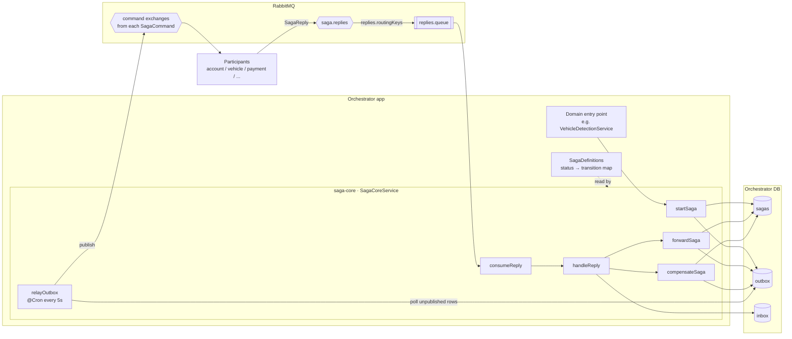
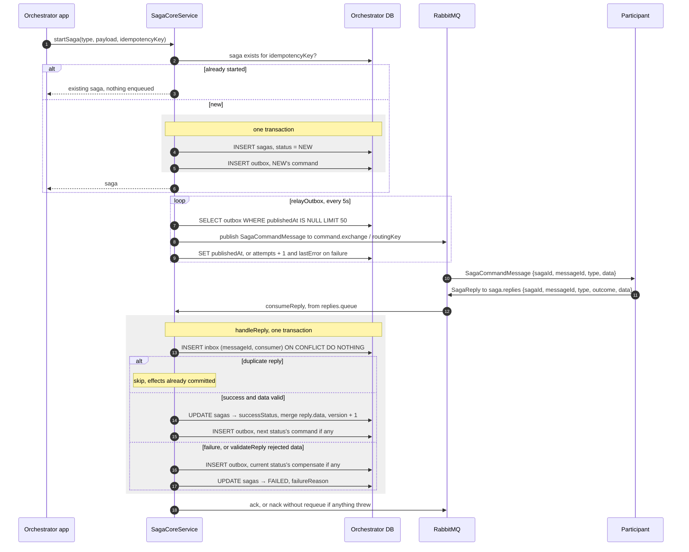
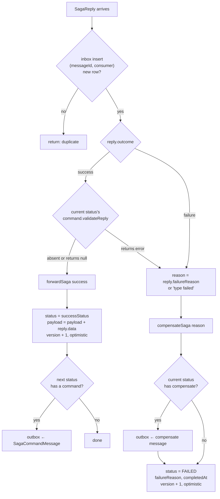
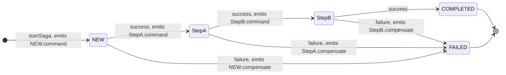

# saga-core

A generic, embeddable saga orchestration engine for NestJS services. Implements the
saga/outbox/inbox pattern: a `sagas` table tracks each saga's current status, an
`outbox` table holds commands to publish over RabbitMQ (relayed by a background job),
and an `inbox` table deduplicates incoming replies.

This package contains no business logic of its own — it only knows how to walk a
state machine you define (a `SagaDefinitions` map) and reliably publish/consume
messages around each transition. Each consuming service supplies its own saga
definitions, its own RabbitMQ exchange/routing-key names, and its own database
connection.

## How it works

### Components

What lives inside saga-core and what the consuming app and the participants own.
Everything inside the `saga-core` box runs in the orchestrator's process, against the
orchestrator's own database.



### One saga, end to end

The app only calls `startSaga`. Every later step is driven by replies, and every
command reaches RabbitMQ through the outbox — never published directly from inside a
transaction.



The next relay tick publishes whatever `handleReply` enqueued, and the loop repeats
until the saga reaches `COMPLETED` or `FAILED`.

### Reply decision

What `handleReply` does with a single reply. All of it runs in one transaction, so if
anything throws, the inbox row is rolled back too and a redelivery is processed from
scratch.



A failure reply goes straight to `compensateSaga`, which sets `FAILED` — it does not
follow the definition's `failureStatus`. `failureStatus` is only used when the app
calls `forwardSaga(sagaId, 'failure')` itself.

### How a definition is walked

A status's `command` is emitted when the saga **enters** that status, and the saga then
waits in it for the reply. So the reply to `NEW`'s command arrives while the saga is
still `NEW`, and `NEW`'s `successStatus` decides where it goes.



Only the compensation of the status the saga is in at the moment of failure is
emitted. Steps that completed earlier are not rolled back (see
[Known limitations](#known-limitations)).

### Delivery guarantees

- **Commands are at-least-once.** The relay marks a row published only *after*
  `publish` returns, so a crash in between republishes it. `messageId` is fixed when
  the row is written, so participants can dedup on it.
- **Replies are processed exactly once per `consumer`.** The inbox row and the saga
  update commit together.
- **Concurrent updates fail loudly.** Every saga update is conditioned on
  `version`. A lost race throws, the transaction rolls back, and the reply is
  currently dropped (nack without requeue).

## Installing

Not published to a registry. Each consumer depends on it via a local path:

```json
"dependencies": {
  "saga-core": "file:../../packages/saga-core"
}
```

Note: Yarn Classic **copies** `file:` dependencies rather than symlinking them. After
changing this package, run `yarn build` here, then `yarn install` (and rebuild the
Docker image, if containerized) in every consuming service to pick up the change.

## Peer dependencies

The consuming app must already have these installed, at compatible versions:

- `@nestjs/common`, `@nestjs/core`
- `@nestjs/typeorm`, `typeorm`
- `@nestjs/schedule` (the outbox relay runs via `@Cron`)
- `amqp-connection-manager`
- `reflect-metadata`

These are peer dependencies, not bundled dependencies, specifically so the consumer's
own instances are what get used — bundling separate copies risks two different
`typeorm`/`@nestjs/*` module instances existing in one process, which can break
decorator metadata resolution (`@InjectRepository`, etc.) in hard-to-diagnose ways.

## Setup

### 1. Register the entities with your DataSource

`SagaCoreModule` only calls `TypeOrmModule.forFeature(...)` — it does **not** register
entity metadata with your connection. Your own `TypeOrmModule.forRoot(...)` call must
include this package's entities explicitly (a glob pattern won't find them, since
they live in `node_modules`, not your own compiled output):

```ts
import { InboxEntity, OutboxEntity, SagaEntity } from 'saga-core';

TypeOrmModule.forRoot({
  // ...your connection config...
  entities: [
    join(__dirname, '..', '**', '*.entity{.ts,.js}'), // your own entities
    SagaEntity,
    OutboxEntity,
    InboxEntity,
  ],
  synchronize: true,
});
```

### 2. Define your saga(s)

A `SagaDefinition` is keyed by **status**, not by saga type — each saga type has
exactly one definition, but that definition needs one entry per step it can be in.
`successStatus`/`failureStatus` say where to go next; `command` is the side effect to
emit upon *entering* that status; `compensate` is how to undo it.

```ts
import { SagaDefinition, SagaStatus } from 'saga-core';

export const REGISTER_VEHICLE_TRANSITIONS: SagaDefinition = {
  [SagaStatus.NEW]: {
    successStatus: 'AccountVerification',
    failureStatus: SagaStatus.FAILED,
    command: {
      exchange: 'account.commands',
      routingKey: 'account.verify',
      // Optional: send only what this participant needs. Without it, the
      // participant receives the saga's whole accumulated payload.
      buildPayload: (p) => ({ plateNumber: p.plateNumber }),
    },
  },
  AccountVerification: {
    successStatus: 'ChargingWallet',
    failureStatus: SagaStatus.FAILED,
  },
  ChargingWallet: {
    successStatus: SagaStatus.COMPLETED,
    failureStatus: 'CompensatingWallet',
    compensate: { exchange: 'payment.commands', routingKey: 'wallet.refund' },
  },
};
```

### 3. Register the module

Call `SagaCoreModule.forRoot(...)` once, from your `AppModule` — it's marked `global`,
so `SagaCoreService` becomes injectable anywhere in the app without re-importing the
module. Also make sure `ScheduleModule.forRoot()` is imported somewhere (the outbox
relay's `@Cron` needs it; this package does not register it itself, since a shared
library shouldn't assume it owns that app-wide concern).

```ts
import { ScheduleModule } from '@nestjs/schedule';
import { SagaCoreModule } from 'saga-core';

@Module({
  imports: [
    ScheduleModule.forRoot(),
    SagaCoreModule.forRoot({
      definitions: {
        RegisterVehicle: REGISTER_VEHICLE_TRANSITIONS,
      },
      consumer: 'vehicle-orchestrator', // inbox dedup key for replies
      replies: {
        queue: 'vehicle-orchestrator.saga.replies',
        routingKeys: ['register-vehicle.reply'],
      },
    }),
    // ...
  ],
})
export class AppModule {}
```

## Reply consumer

saga-core consumes participant replies itself — the app doesn't write a reply
handler. On startup it asserts the `saga.replies` direct exchange, asserts
`replies.queue`, binds it with every key in `replies.routingKeys`, and for each
`SagaReply` on that queue calls `handleReply(reply, consumer)` and acks. A reply that
fails to process is logged and nacked without requeue (no DLX yet).

## Using `SagaCoreService`

- **`startSaga({ type, payload, idempotencyKey })`** — creates a saga (idempotent on
  `idempotencyKey`: calling it again with the same key returns the existing saga
  instead of creating a duplicate), and enqueues the `NEW` status's command, if any,
  in the same transaction.
- **`forwardSaga(sagaId, outcome, context?)`** — advances a saga from its current
  status based on `'success' | 'failure'`, using optimistic concurrency (throws if the
  saga's `version` changed concurrently). Enqueues the next status's command, if any,
  in the same transaction as the status update.
- **`compensateSaga(sagaId, reason)`** — emits the *current* status's `compensate`
  command (if defined) and marks the saga `FAILED`. **Does not** walk backward through
  every previously-completed step — only the current one. A full rollback chain needs
  a `prev` pointer per step, which isn't implemented yet.
- **`markProcessed(messageId, consumer, messageType)`** — inbox dedup guard for
  incoming reply consumers. Returns `false` if this `(messageId, consumer)` pair was
  already recorded (meaning: skip it, it's a redelivery); `true` if newly recorded.

## Command message format

Every command (and compensation) is published as a `SagaCommandMessage`:

```ts
{
  sagaId: string;    // echo this back in the reply so the orchestrator can forwardSaga()
  messageId: string; // stable across relay retries - use it with markProcessed()
  type: string;      // the command's routingKey
  data: object;      // command.buildPayload(sagaPayload), or the whole payload if omitted
}
```

`saga.payload` itself stays the orchestrator's private state: replies passed to
`forwardSaga(sagaId, outcome, context)` are merged into it, and each step's
`buildPayload` picks what its participant should see.

## Outbox relay

A `@Cron('*/5 * * * * *')` job polls `outbox` for unpublished rows and publishes them.
Each row carries its own `exchange`/`routingKey`/`payload` — the relay asserts the
exchange on demand (as `direct`, cached after the first time) and publishes, with no
knowledge of what exchanges exist ahead of time. On failure, `attempts`/`last_error`
are recorded and the row is retried on the next tick.

## Known limitations

- `compensateSaga` only compensates the current step (see above).
- The outbox relay asserts every exchange as `type: 'direct'` — a saga needing to
  publish to a `fanout`/`topic` exchange isn't supported yet.
- No admin/inspection HTTP surface is exposed by default beyond an empty
  `SagaCoreController` (mounted at `/saga-core` in whatever app imports this module).
